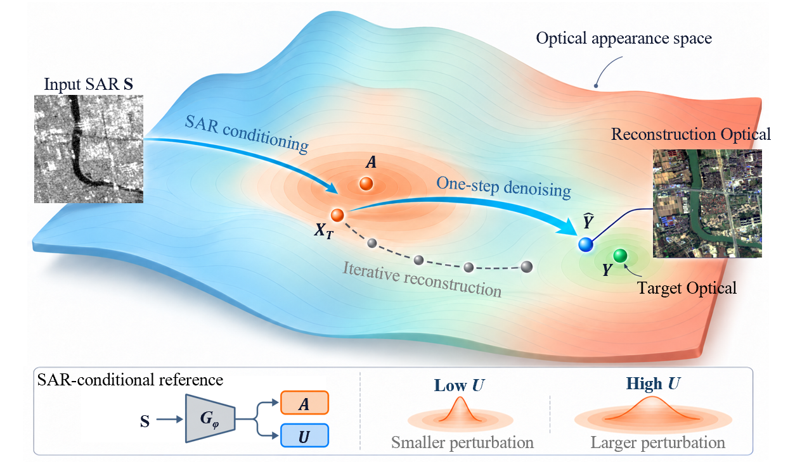
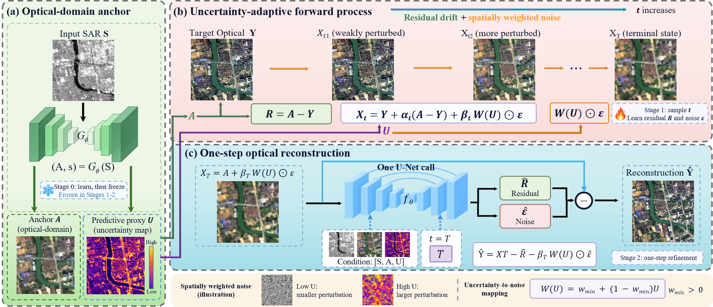
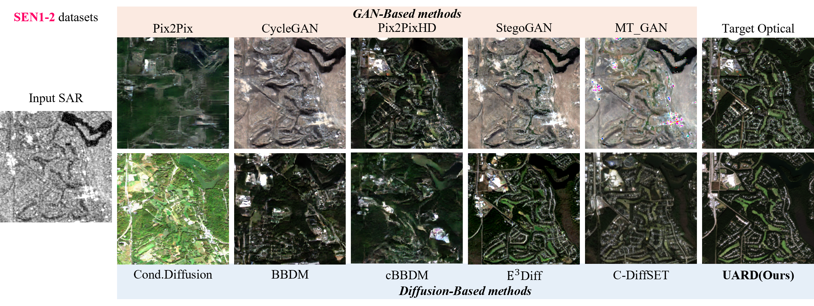
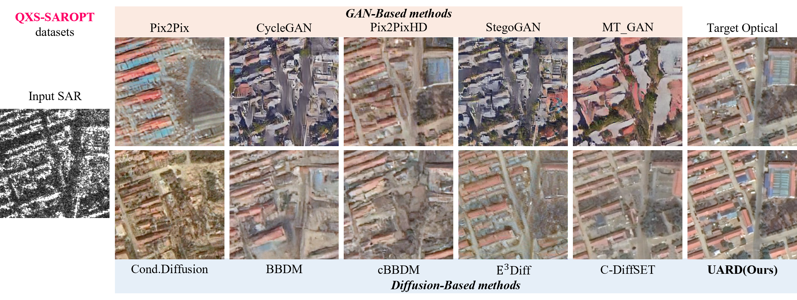
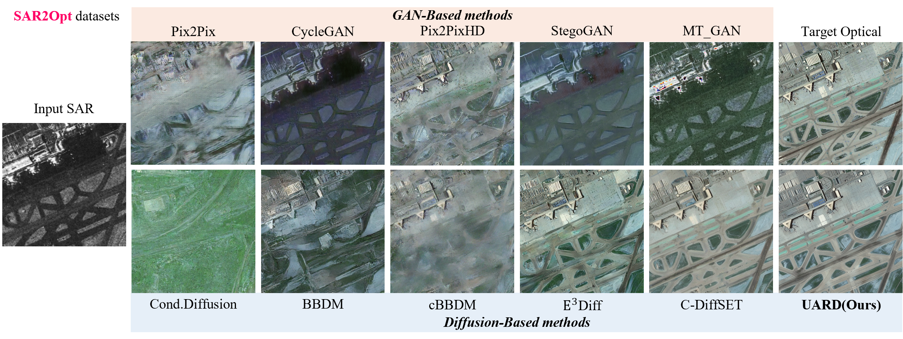

# UARD：不确定性自适应残差扩散

**通过光学域锚点与空间自适应扰动，实现一步 SAR 到光学图像转换。**

[English](README.md) · [配置与数据](docs/CONFIGURATION.md) · [发布范围](RELEASE_SCOPE.md)

## 研究动机

SAR 到光学转换需要从不同成像机制的观测中恢复光学外观。图像各区域的预测难度并不相同。UARD 先建立光学域参考，再用空间预测尺度调节生成细化过程中的扰动。



*概念示意：光学锚点决定终态分布的中心，预测尺度控制局部噪声幅度。曲面与路径用于解释方法，并非实测扩散轨迹。*

## 方法概览

UARD 将三个环节连接起来：

1. **光学锚点与预测尺度。** 通过异方差回归，从 SAR 学习光学域锚点 **A** 和空间预测尺度 **U**。预测尺度表征跨模态预测不确定性。
2. **不确定性自适应残差过程。** 残差 **A − Y** 在光学域内定义校正路径。空间权重 **W(U)** 调节沿途的高斯扰动。
3. **一步光学重建。** 共享去噪网络联合预测残差与噪声。终态重建与感知细化训练最终的单次调用重建。



*架构示意：S0 学习锚点与尺度，S1 学习残差/噪声预测，S2 细化终态重建。“一步”指一次去噪网络调用；总推理仍包含 S0 预测器的计算。*

## 视觉对比

### SEN1-2



<details>
<summary><strong>QXS-SAROPT</strong></summary>



</details>

<details>
<summary><strong>SAR2Opt</strong></summary>



</details>

## 源码预览版

当前支持 S0 训练、锚点导出，以及对已有图像进行独立评测。`UARDiffusion.q_sample` 和 `UARDiffusion.generate` 的函数体暂不公开，调用时抛出 `NotImplementedError`，因此当前不支持 S1/S2 训练、扩散生成及完整论文复现，详见[发布范围](RELEASE_SCOPE.md)。

仓库保留模型结构、训练循环、数据加载器与九份配置模板。执行 `python release_status.py` 可查看开放状态。

## 安装

建议使用 Python 3.10，并按 CPU/CUDA 环境选择匹配的 PyTorch 与 torchvision。

```bash
git clone https://github.com/iroseo/Uncertainty-Adaptive-Residual-Diffusion.git
cd Uncertainty-Adaptive-Residual-Diffusion
python -m pip install -r requirements.txt
```

依赖文件提供建议组合，不代表已核实的历史实验环境或已完成 GPU 全面验证的锁定环境。配置启用 `portable_pool: true`，无需编译 SoftPool 扩展。日志及 LMDB 的可选依赖见 [requirements-optional.txt](requirements-optional.txt)。LPIPS/FID 首次运行可能下载预训练特征网络权重。

## S0 训练

按照[数据目录说明](docs/CONFIGURATION.md) 放置对齐的 8 位图像对，然后在仓库根目录执行：

```bash
python train_anchor.py --config config/UARD_anchor_s0.json --output experiments/s0 --device cuda:0
```

QXS-SAROPT 和 SAR2Opt 分别使用 `config/UARD_QXS_s0.json` 与 `config/UARD_SAR2Opt_512_s0.json`。训练前先检查数据路径。仓库中的 JSON 是开发模板，不代表论文最终实验配方。数据检查、仅准备配置的命令、阶段设置和配对规则见[配置指南](docs/CONFIGURATION.md)。

## 已有图像评测

下列工具直接读取已有预测图像，无需调用 UARD 生成器：

```bash
python tools/check_pairs.py --pred-root predictions --gt-dir targets --expected-count 1600 --sha256 --output pair_audit.json
python tools/evaluate.py --pred_root predictions --gt_dir targets --device cpu --expected-count 1600 --output results/evaluation
```

图像应放在平面目录中，以完整文件主名配对。将 `1600` 改为实际评测数量，并使用新的输出路径。工具不会自动移除 `test_` 等前缀。`evaluate_uard.py` 是依赖生成模型的入口，当前预览版不支持运行。

独立评测器计算 **FID、LPIPS-Alex、PSNR、SSIM 和 RGB MSE**（字段 `l2`），不包含 SSF。LPIPS-Alex 与旧代码中的 VGG 协议不同，数值不可混用。预处理和输出细节见[指标协议](docs/CONFIGURATION.md#metric-protocol)。

## 目录说明

| 位置 | 内容 |
| --- | --- |
| `model/` | 锚点/尺度预测器、去噪网络、扩散源码、损失与训练封装 |
| `main.py`、`train_anchor.py`、`train_qxs.py`、`train_sar2opt.py` | 训练与配置准备入口 |
| `config/` | 九份数据集/阶段开发配置 |
| `data/`、`core/`、`uard_io.py`、`qxs_data.py` | 数据加载与辅助工具 |
| `tools/` | 独立图像配对与评测 |
| `assets/figures/` | 方法示意与视觉对比 |

## 致谢与许可

实现基于 [E3Diff](https://github.com/DeepSARRS/E3Diff) 及其上游 [SR3 PyTorch 实现](https://github.com/Janspiry/Image-Super-Resolution-via-Iterative-Refinement)，并使用 [SoftPool](https://github.com/alexandrosstergiou/SoftPool) 的池化基础设施。来源、第三方声明及预览版改动见 [THIRD_PARTY_NOTICES.md](THIRD_PARTY_NOTICES.md)、[licenses/](licenses/) 和 [SOURCE_CHANGES.md](docs/SOURCE_CHANGES.md)。

当前预览版尚未选定额外的 UARD 项目许可证，第三方代码遵循其适用条款。仓库不附带数据集与检查点。
